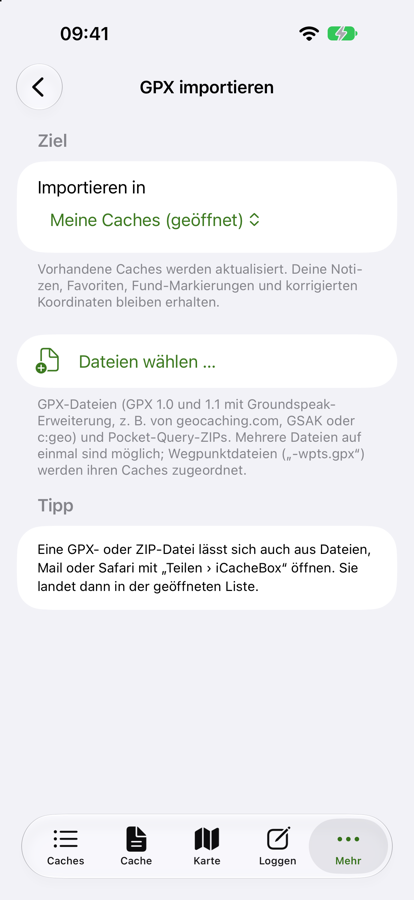
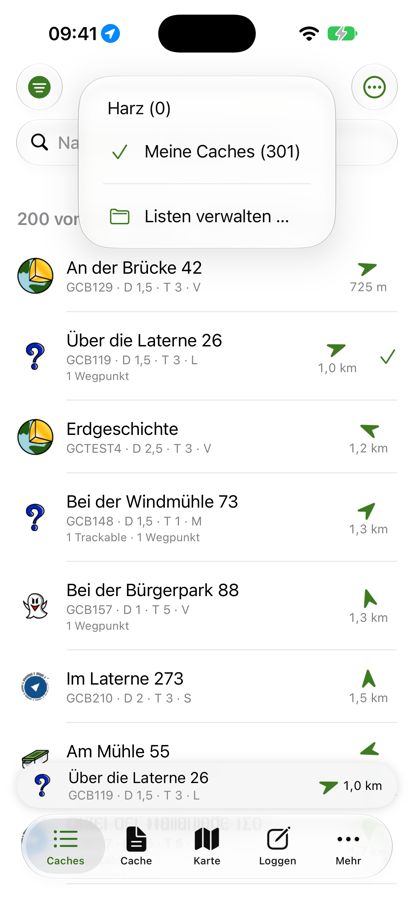
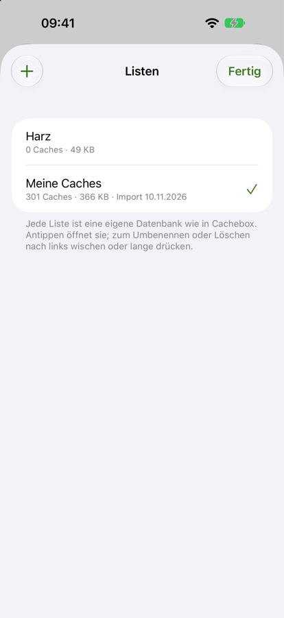
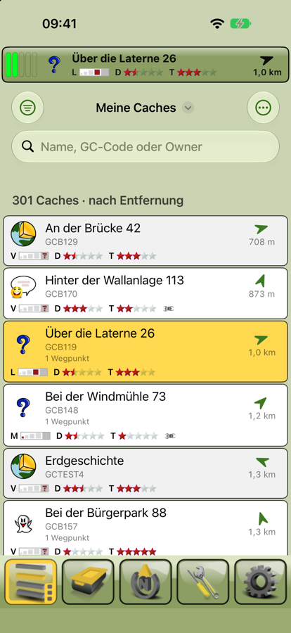
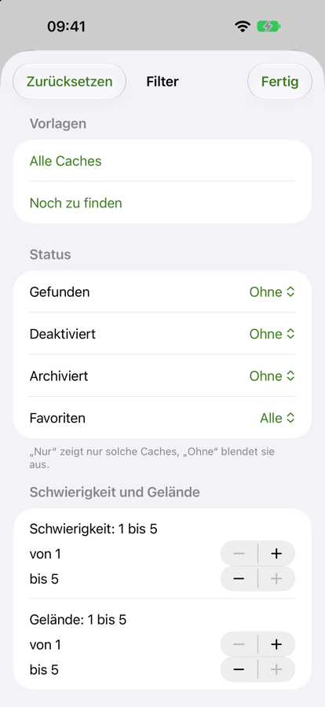
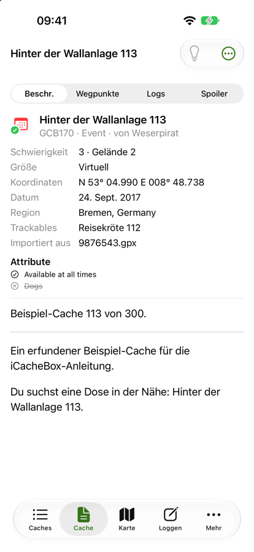
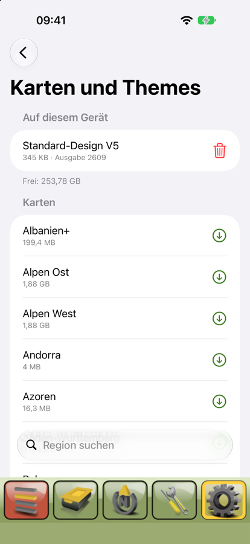
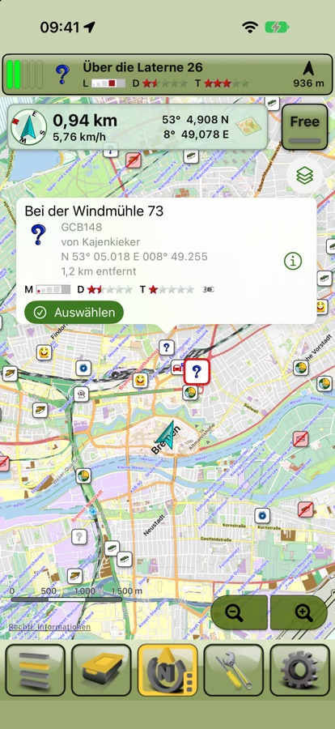
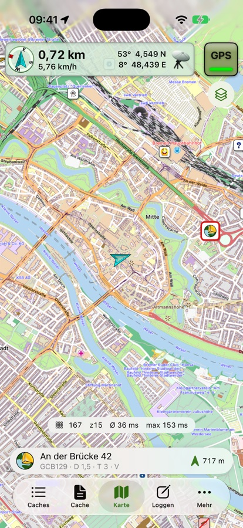

# iCacheBox – Anleitung

iCacheBox ist Cachebox für das iPhone: deine Geocaches und Offline-Karten auf dem Gerät, auch dort, wo es kein Netz gibt.
Diese Anleitung beschreibt den aktuellen Prototyp (Stand November 2026). Was noch fehlt, steht am Ende.

## Überblick

Die App hat unten fünf Bereiche:

| Bereich | Wofür |
| --- | --- |
| **Caches** | Die Caches der geöffneten Liste, sortiert nach Entfernung. Hier importierst du GPX-Dateien und verwaltest deine Listen. |
| **Cache** | Alles zum gewählten Cache: Beschreibung, Wegpunkte, Logs, Hinweis und deine Notiz. |
| **Karte** | Die Offline-Karte mit frei wählbarem Design, darauf die Caches der Liste und die Wegpunkte des gewählten Caches. |
| **Loggen** | Log-Entwürfe (noch im Aufbau). |
| **Mehr** | Geocaching-Konto, GPX-Import, Karten und Themes, Einstellungen. |

Der gewählte Cache steht als Leiste über den Bereichen (mehr dazu im Abschnitt „Der gewählte Cache“).

## Erste Schritte

1. Lade eine GPX-Datei oder Pocket Query auf dein iPhone, zum Beispiel aus einer Mail oder über die Dateien-App.
2. Öffne **Caches** und tippe auf **GPX importieren**. iCacheBox legt dabei deine erste Liste „Meine Caches“ an.
3. Erlaube beim ersten Mal den Zugriff auf deinen Standort. Dann sortiert die App die Caches nach Entfernung und zeigt
   Richtung und Abstand zu jedem Cache.
4. Lade unter **Mehr › Karten und Themes** eine Offline-Karte deiner Gegend.

## Caches importieren

iCacheBox liest GPX-Dateien, wie sie geocaching.com, GSAK, c:geo und Opencaching erzeugen
(GPX 1.0 und 1.1 mit Groundspeak-Erweiterung), und Pocket Queries als ZIP-Datei.

So importierst du:

1. Tippe in **Caches** oben rechts auf **⋯ › GPX importieren** oder gehe zu **Mehr › GPX importieren**.
2. Wähle unter **Importieren in** die Liste, in die die Caches sollen: die geöffnete, eine andere oder eine
   **Neue Liste** mit eigenem Namen.
3. Tippe auf **Dateien wählen** und wähle eine oder mehrere Dateien aus. Mehrere Dateien auf einmal sind kein
   Problem.

Oben erscheint dann eine Anzeige mit dem Fortschritt, am Ende mit einer Zusammenfassung, zum Beispiel
„301 neue Caches, 159 Wegpunkte, 780 Logs“. Mit **Abbrechen** hältst du einen langen Import an; was bis dahin
gelesen ist, bleibt in der Liste. Nach dem Import ist die Zielliste geöffnet.

**Schneller Weg:** Eine GPX- oder ZIP-Datei lässt sich auch direkt aus Dateien, Mail oder Safari öffnen:
**Teilen › iCacheBox**. Sie landet dann in der geöffneten Liste.

**Pocket Queries:** Eine Pocket Query besteht aus zwei Dateien, den Caches (`1234567.gpx`) und den zusätzlichen
Wegpunkten (`1234567-wpts.gpx`). Importiere einfach die ZIP-Datei; iCacheBox ordnet Parkplätze, Stationen und
Finals ihren Caches zu.

**Erneut importieren:** Importierst du einen Cache, der schon in der Liste ist, aktualisiert iCacheBox ihn mit den
neuen Daten (Beschreibung, Status, Logs). Erhalten bleiben deine Notiz, deine Favoriten-Markierung, korrigierte
Koordinaten und die Markierung „gefunden“. Eine leere Beschreibung in der neuen Datei überschreibt die alte nicht.

## Listen verwalten

Wie in Cachebox ist jede Liste eine eigene Datenbank, zum Beispiel eine für zu Hause und eine für den Urlaub.

- **Liste wechseln:** Tippe in **Caches** auf den Namen der Liste oben in der Mitte und wähle eine andere.
  iCacheBox merkt sich je Liste den zuletzt gewählten Cache.
- **Listen verwalten:** Im selben Menü öffnet **Listen verwalten** die Übersicht mit Anzahl der Caches,
  Speicherbedarf und letztem Import.
- **Neue Liste:** In der Übersicht mit **+**.
- **Umbenennen oder löschen:** Eine Liste nach links wischen oder lange drücken. Löschen entfernt die Liste mit
  allen Caches, Notizen und Markierungen; das lässt sich nicht rückgängig machen.

## Die Cacheliste

Jede Zeile zeigt:

- links das Symbol des Cache-Typs wie in Cachebox (bei korrigierten Koordinaten in der „gelösten“ Variante),
  darauf ein Smiley für gefunden, ein Herz für Favorit und ein Verbotszeichen, wenn der Cache deaktiviert ist, bzw.
  ein Leitkegel, wenn er archiviert ist;
- den Namen (rot, wenn der Cache nicht verfügbar ist, durchgestrichen, wenn er archiviert ist);
- GC-Code, Schwierigkeit (D), Gelände (T) und Größe (M = Micro, S = Small, R = Regular, L = Large, V = virtuell,
  O = andere);
- falls vorhanden Trackables, Favoritenpunkte und zusätzliche Wegpunkte;
- rechts die Entfernung und einen Pfeil in Richtung des Caches, beim gewählten Cache zusätzlich einen Haken.

Über der Liste steht, wie viele Caches du siehst, zum Beispiel „200 von 301 Caches · nach Entfernung“.

**Cache wählen:** Antippen wählt den Cache und öffnet seine Details. Nach rechts wischen zeigt ihn auf der Karte,
nach links wischen markiert ihn als Favorit. Langes Drücken bietet außerdem **Als gefunden markieren**.

**Suchen:** Das Suchfeld findet Caches nach Name, GC-Code oder Owner.

**Sortieren:** Unter **⋯ › Sortieren** stehen Entfernung, Name, GC-Code, Schwierigkeit, Gelände, Neueste zuerst
und Favoritenpunkte zur Wahl. Ohne Standort misst iCacheBox die Entfernung vom gewählten Cache aus; der Pfeil ist
dann grau.

**Filtern:** Das Filtersymbol oben links öffnet den Filter. Es ist gefüllt, solange ein Filter aktiv ist.

- **Vorlagen:** „Alle Caches“ oder „Noch zu finden“ (nicht gefunden, verfügbar, nicht archiviert).
- **Status:** Für Gefunden, Deaktiviert, Archiviert und Favoriten jeweils „Alle“, „Nur“ oder „Ohne“.
- **Schwierigkeit und Gelände:** Bereich von 1 bis 5.
- **Typen:** Nur die angehakten Cache-Typen; ohne Auswahl alle.

**Aufräumen:** Unter **⋯ › Caches löschen** entfernst du alle gefundenen, alle archivierten oder alle gerade
angezeigten Caches aus der Liste. Ein erneuter Import holt sie zurück.

## Der gewählte Cache

Wie in Cachebox gibt es immer einen gewählten Cache, mit dem du gerade unterwegs bist. Er steht als Leiste über den
Bereichen **Caches**, **Karte**, **Loggen** und **Mehr**: Typ-Symbol, Name, GC-Code, Schwierigkeit, Gelände und
Größe, mit Standort auch Entfernung und ein Pfeil in seine Richtung.

- **Antippen** öffnet seine Details.
- **Lange drücken** bietet **Details** und **Auf der Karte**.
- **Auf der Karte** ist der gewählte Cache immer eingezeichnet; wählst du einen anderen, springt die Karte zu ihm
  (siehe „Offline-Karten“).

iCacheBox merkt sich je Liste den zuletzt gewählten Cache, auch nach einem Neustart. Wechselst du die Liste, ist
deren zuletzt gewählter Cache wieder gewählt; in einer neuen Liste ist zunächst keiner gewählt und die Leiste
verschwindet.

## Cache-Details

Der Bereich **Cache** zeigt den gewählten Cache. Oben schaltest du um zwischen:

- **Beschreibung:** Typ, Owner, Schwierigkeit und Gelände, Größe, Koordinaten, Versteckdatum, Region,
  Favoritenpunkte, Trackables, die Attribute als Symbole (durchgestrichen = trifft nicht zu, Tippen zeigt den Text)
  und die Beschreibung des Owners. Links in der Beschreibung öffnen Safari.
- **Wegpunkte:** Der Cache selbst und alle zusätzlichen Wegpunkte mit Typ, Koordinaten, Kommentar und Entfernung.
  Wegpunkte mit verborgenen Koordinaten sind als solche markiert.
- **Logs:** Die Logs aus der GPX-Datei, die neuesten zuerst.
- **Spoiler:** Spoilerbilder lädt iCacheBox noch nicht.

Die Glühbirne oben rechts zeigt den **Hinweis**. Unter **⋯** findest du außerdem: auf der Karte zeigen, als
gefunden markieren, Favorit, **Notiz bearbeiten** (deine eigene Notiz, die beim nächsten Import erhalten bleibt),
Koordinaten kopieren, im Browser öffnen und den Cache aus der Liste löschen.

## Offline-Karten

iCacheBox zeichnet Mapsforge-Karten direkt auf dem iPhone, ganz ohne Netz.

**Karten laden:** Unter **Mehr › Karten und Themes** stehen die Freizeitkarten des Freizeitkarte-OSM-Projekts für
ganz Europa. Tippe auf den Pfeil neben einer Region. Große Karten (ab 100 MB) fragen vorher nach und zeigen den
nötigen Speicherplatz. Der Download läuft weiter, wenn du die App verlässt; der Stopp-Knopf hält ihn an, das
Abspielsymbol setzt ihn fort. Mit der ersten Karte lädt iCacheBox das passende Design „Standard-Design V5“ mit.

**Karte anzeigen:** Im Bereich **Karte** wählst du über das Ebenen-Symbol unter dem GPS-Knopf die Karte, das
Theme und den Stil. Freizeitkarten bekommen automatisch ihr Design.

Beim nächsten Start zeigt die Karte wieder dieselbe Karte mit demselben Design, Stil und Ausschnitt wie beim
letzten Mal.

**Caches auf der Karte:** Alle Caches der geöffneten Liste stehen mit ihren Cachebox-Symbolen auf der Karte; ein
Filter der Liste gilt auch hier. Ab Zoomstufe 15 sind die Symbole groß, bei 13 und 14 kleiner, weiter draußen
zeigen kleine Symbole nur noch die Art des Caches. Gefundene Caches erscheinen als Smiley, nicht verfügbare und
archivierte rot durchgestrichen, Favoriten mit Herz. Hat ein Cache korrigierte Koordinaten oder einen Final-Wegpunkt
mit Koordinaten (etwa einen gelösten Mystery), steht er dort und bekommt das „gelöst“-Symbol; die Entfernung in der
Liste zählt dann ebenfalls bis dorthin.

**Gewählter Cache:** Er hat einen roten Rahmen, ist immer groß und liegt obenauf. Dazu kommen seine zusätzlichen
Wegpunkte (Parkplatz, Stationen, Final), soweit sie Koordinaten haben.

**Info-Blase:** Ein Tipp auf einen Cache – oder knapp daneben – öffnet seine Info-Blase: Art, GC-Code,
Schwierigkeit, Gelände und Größe, Owner (bei Events auch das Datum), Koordinaten und mit Standort die Entfernung.
**Auswählen** macht ihn zum gewählten Cache, der Info-Knopf öffnet seine Details.

Die Karte springt zum Cache, wenn du einen anderen Cache wählst oder **Auf der Karte** nutzt: in der Liste nach
rechts wischen, lange auf einen Cache oder die Leiste drücken oder im Cache-Menü **⋯ › Auf Karte zeigen**. Im
GPS-Modus (siehe unten) bleibt die Karte beim Wählen bei dir; nur **Auf der Karte** schaltet auf Free und zeigt den
Cache. Deckt die eingestellte Karte den Ort nicht ab, nimmt iCacheBox von selbst eine andere vorhandene Karte, die
ihn abdeckt. Gibt es keine, steht der Cache auf leerem Grund und ein Hinweis erscheint; die passende Karte lädst du
dann unter **Mehr › Karten und Themes**.

### Eigene Position, GPS und Free

**Eigene Position:** Ein Pfeil zeigt, wo du bist und wohin du schaust. Rot heißt: die Richtung kommt vom Kompass
(im Stehen und unter 5 km/h). Türkis heißt: sie kommt von GPS, also aus deiner Bewegungsrichtung. Ist die Ortung
ungenau, liegt ein blauer Kreis um den Pfeil, so groß wie die Ungenauigkeit.

**GPS und Free:** Der grüne Knopf oben rechts zeigt, ob die Karte dir folgt.

- **GPS** mit grüner Leuchte: Die Karte hält deine Position in der Mitte, auch beim Zoomen und Drehen.
- **Free** ohne Leuchte: Die Karte bleibt, wo du sie hinschiebst. Sobald du die Karte im GPS-Modus mit einem Finger
  verschiebst, schaltet der Knopf auf Free.
- **Free antippen** springt zu deiner Position und schaltet wieder auf GPS.

Beim nächsten Start ist der zuletzt gewählte Modus wieder eingestellt. Ohne Standort-Freigabe bleibt der Knopf auf
Free; ein Tipp darauf sagt, wo du die Freigabe erteilst.

**Infofeld:** Links neben dem Knopf stehen wie in Cachebox die wichtigsten Werte:

- ein **Kompass**, dessen Pfeil zum gewählten Cache zeigt (gedreht wie das iPhone in deiner Hand),
- die **Entfernung** zum gewählten Cache und darunter deine **Geschwindigkeit**,
- die **Koordinaten** der Kartenmitte. Das Symbol daneben sagt, woher sie kommen: Satellit für deine Position (GPS),
  Karte für die Mitte des Ausschnitts (Free).

**Pfeile am Kartenrand:** Liegt deine Position außerhalb des sichtbaren Ausschnitts, zeigt ein **blauer Pfeil** am
Rand in ihre Richtung; ein Tipp darauf springt zu dir und schaltet auf GPS. Ein **roter Pfeil** zeigt wie in
Cachebox zum gewählten Cache, wenn er nicht zu sehen ist; ein Tipp darauf zeigt den Cache.

**Löschen:** Unter **Auf diesem Gerät** hat jede Karte und jedes Design einen roten Mülleimer. Vor dem Löschen
fragt die App nach und zeigt, wie viel Speicher frei wird.

**Quellenangabe:** Karten: FZK-Projekt (CC BY 3.0) · Kartendaten © OpenStreetMap-Mitwirkende (ODbL) ·
Höhenlinien: sonny.4lima.de.

## Fragen und Antworten

**Woher bekomme ich GPX-Dateien?**
Von geocaching.com (einzelne Caches als „GPX-Datei“, Pocket Queries mit Premium-Mitgliedschaft), aus GSAK, aus
c:geo (Export als GPX) oder von Opencaching. Auch Cachebox für Android exportiert GPX-Dateien.

**Wo liegen meine Daten?**
Nur auf dem iPhone. Jede Liste ist eine SQLite-Datei; Karten und Designs liegen ebenfalls auf dem Gerät.
Karten sind von der iCloud-Sicherung ausgenommen, weil sie sich jederzeit wieder laden lassen.

**Warum fehlt die Entfernung?**
Ohne Freigabe des Standorts misst iCacheBox vom gewählten Cache aus. Die Freigabe änderst du in den
iOS-Einstellungen unter **Datenschutz & Sicherheit › Ortungsdienste › iCacheBox**.

**Die Datei lässt sich nicht importieren.**
iCacheBox braucht GPX-Dateien mit Geocaches (Groundspeak-Erweiterung). Reine Track- oder Routendateien enthalten
keine Caches. Ist die Datei beschädigt, nennt die Fehlermeldung die Zeile, an der das Lesen scheiterte.

## Noch nicht enthalten

Im Vergleich zu Cachebox für Android fehlen noch: Laden und Aktualisieren über die Geocaching-API, Spoilerbilder,
Kompass und Navigation, die Kartenmodi WP, Lock und Car, Feldnotizen hochladen, Solver, Tracks und Trackables.
