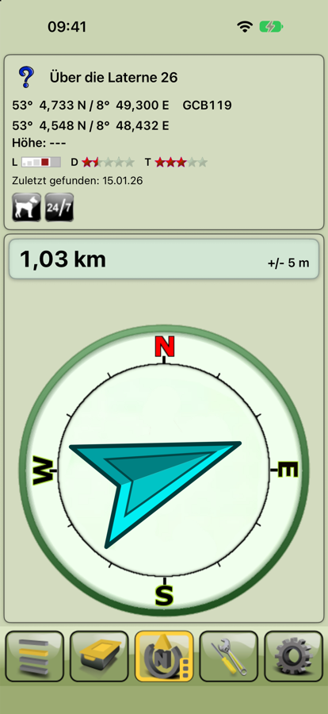
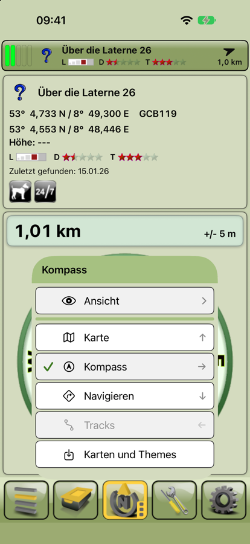
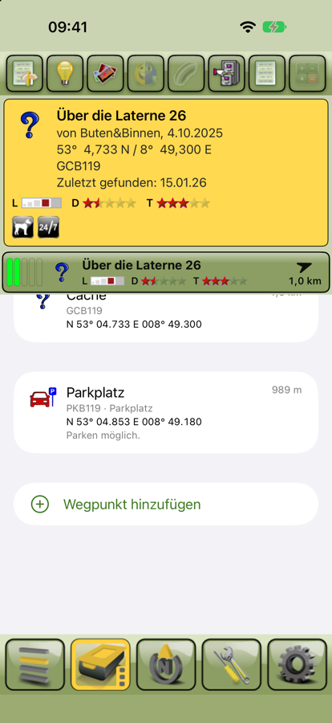
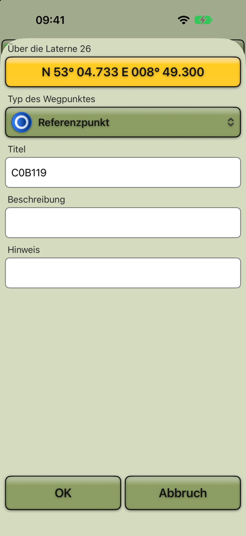
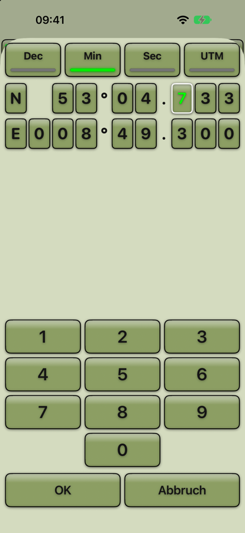
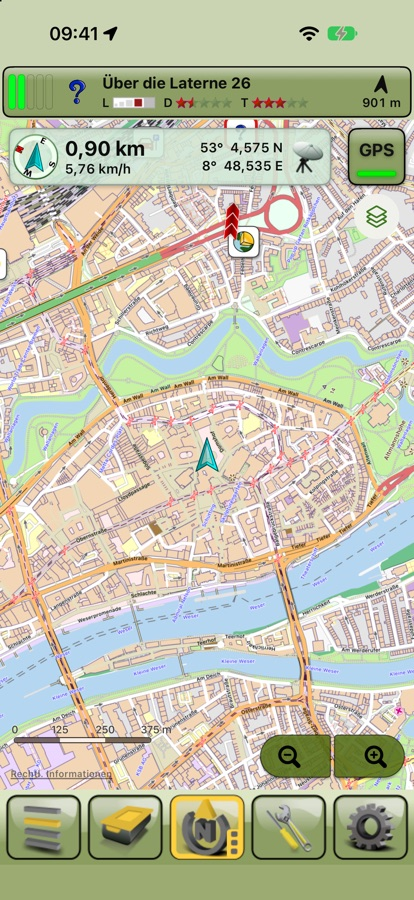
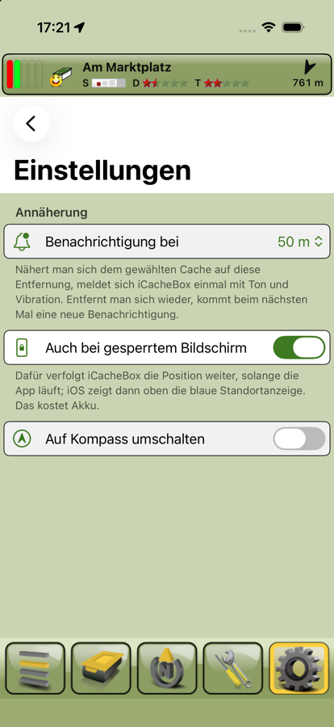

# iCacheBox – Anleitung

iCacheBox ist Cachebox für das iPhone: deine Geocaches und Offline-Karten auf dem Gerät, auch dort, wo es kein Netz gibt.
Diese Anleitung beschreibt den aktuellen Prototyp (Stand November 2026). Was noch fehlt, steht am Ende.

## Überblick

Unten sitzen wie in Cachebox fünf Knöpfe. Jeder gehört zu einem Bereich mit mehreren Ansichten:

| Knopf | Ansichten und Funktionen |
| --- | --- |
| **Cacheliste** (Stapel) | Die Caches der geöffneten Liste, sortiert nach Entfernung; Import und Listen. Außerdem **Teilen** des gewählten Caches. |
| **Cache** (Dose) | Alles zum gewählten Cache: **Beschreibung**, **Wegpunkte**, **Logs**, **Spoiler**, dazu **Hinweis**, **Notizen** und **Im Browser öffnen**. |
| **Navigation** (N-Pfeil) | **Karte** und **Kompass**, **Navigieren** mit Apple Karten und **Karten und Themes** (Download). |
| **Werkzeuge** (Schraubenschlüssel) | **Entwürfe** für Logs (noch im Aufbau), später Solver, Foto und Sprachnotiz. |
| **Sonstiges** (Zahnrad) | **Mehr**: Geocaching-Konto, GPX-Import, Karten und Themes, Einstellungen und **Über** (Version und Build-Zeit); außerdem die **Taschenlampe**. |

Der gewählte Cache steht oben als Leiste über jeder Ansicht. Ziehst du sie herunter, erscheinen darüber die
**Zusatzknöpfe** (mehr dazu im Abschnitt „Der gewählte Cache und die Zusatzknöpfe“).

Die Menüs sehen aus wie in Cachebox: ein grüner Kasten mit Titel, die Einträge als helle Felder, ein Häkchen
vor dem, was eingeschaltet ist. Ein Pfeil `>` rechts öffnet ein Untermenü, `<` oben links führt zurück.

## Die fünf Knöpfe

Die Knöpfe funktionieren wie in Cachebox:

- **Antippen** zeigt die Ansicht des Knopfs, und zwar die, die du dort zuletzt hattest. Beim ersten Mal ist das die
  Grundansicht (Cacheliste, Beschreibung, Karte, Mehr). Der Werkzeuge-Knopf hat keine Grundansicht und öffnet gleich
  sein Menü.
- Der Knopf der gezeigten Ansicht ist **gelb**. Tippst du ihn noch einmal an, öffnet sich sein **Menü**: oben die
  Funktionen der gezeigten Ansicht (zum Beispiel Sortieren und Filter bei der Liste, „Ansicht“ beim Kompass),
  darunter alle Ansichten und Funktionen des Knopfs. Drei Punkte unten rechts im Knopf zeigen, dass die Ansicht
  eigene Funktionen hat; rot sind sie, solange ein Filter gesetzt ist.
- **Wischen** über einen Knopf springt direkt zu einer Funktion, ohne Menü. Welche Richtung wohin führt, steht als
  kleiner Pfeil im Menü, zum Beispiel beim Navigations-Knopf: nach oben **Karte**, nach rechts **Kompass**, nach
  unten **Navigieren**.
- **Lange drücken** öffnet das Menü mit allen Funktionen des Knopfs, egal welche Ansicht gerade zu sehen ist.

Ist ein Filter in der Cacheliste gesetzt, ist der Cacheliste-Knopf **rot**. Ausgegraute Einträge im Menü gibt es
noch nicht (siehe „Noch nicht enthalten“).

Während du tippst (Suche, Import), verschwinden die Knöpfe hinter der Tastatur.

## Erste Schritte

1. Lade eine GPX-Datei oder Pocket Query auf dein iPhone, zum Beispiel aus einer Mail oder über die Dateien-App.
2. Öffne die **Cacheliste** und tippe auf **GPX importieren**. iCacheBox legt dabei deine erste Liste
   „Meine Caches“ an.
3. Erlaube beim ersten Mal den Zugriff auf deinen Standort. Dann sortiert die App die Caches nach Entfernung und zeigt
   Richtung und Abstand zu jedem Cache.
4. Lade unter **Sonstiges › Karten und Themes** (oder im Menü des Navigations-Knopfs) eine Offline-Karte deiner
   Gegend.

## Caches importieren

iCacheBox liest GPX-Dateien, wie sie geocaching.com, GSAK, c:geo und Opencaching erzeugen
(GPX 1.0 und 1.1 mit Groundspeak-Erweiterung), und Pocket Queries als ZIP-Datei.

So importierst du:

1. Tippe in der **Cacheliste** oben rechts auf **⋯ › GPX importieren** (dasselbe steht im Menü des
   Cacheliste-Knopfs) oder gehe zu **Sonstiges › GPX importieren**.
2. Wähle unter **Importieren in** die Liste, in die die Caches sollen: die geöffnete, eine andere oder eine
   **Neue Liste** mit eigenem Namen.
3. Tippe auf **Dateien wählen** und wähle eine oder mehrere Dateien aus. Mehrere Dateien auf einmal sind kein
   Problem.

Oben erscheint dann eine Anzeige mit dem Fortschritt, am Ende mit einer Zusammenfassung, zum Beispiel
„301 neue Caches, 159 Wegpunkte, 780 Logs“. Mit **Abbrechen** hältst du einen langen Import an; was bis dahin
gelesen ist, bleibt in der Liste. Nach dem Import ist die Zielliste geöffnet.

**Schneller Weg:** Eine GPX- oder ZIP-Datei lässt sich auch direkt aus Dateien, Mail oder Safari öffnen:
**Teilen › iCacheBox**. Sie landet dann in der geöffneten Liste.

**Pocket Queries:** Eine Pocket Query besteht aus zwei Dateien, den Caches (`1234567.gpx`) und den zusätzlichen
Wegpunkten (`1234567-wpts.gpx`). Importiere einfach die ZIP-Datei; iCacheBox ordnet Parkplätze, Stationen und
Finals ihren Caches zu.

**Erneut importieren:** Importierst du einen Cache, der schon in der Liste ist, aktualisiert iCacheBox ihn mit den
neuen Daten (Beschreibung, Status, Logs). Erhalten bleiben deine Notiz, deine Favoriten-Markierung, korrigierte
Koordinaten und die Markierung „gefunden“. Eine leere Beschreibung in der neuen Datei überschreibt die alte nicht.

## Listen verwalten

Wie in Cachebox ist jede Liste eine eigene Datenbank, zum Beispiel eine für zu Hause und eine für den Urlaub.

- **Liste wechseln:** Tippe in der **Cacheliste** auf den Namen der Liste oben in der Mitte und wähle eine andere.
  iCacheBox merkt sich je Liste den zuletzt gewählten Cache.
- **Listen verwalten:** Im selben Menü öffnet **Listen verwalten** die Übersicht mit Anzahl der Caches,
  Speicherbedarf und letztem Import.
- **Neue Liste:** In der Übersicht mit **+**.
- **Umbenennen oder löschen:** Eine Liste nach links wischen oder lange drücken. Löschen entfernt die Liste mit
  allen Caches, Notizen und Markierungen; das lässt sich nicht rückgängig machen.

## Die Cacheliste

Jede Zeile zeigt:

- links das Symbol des Cache-Typs wie in Cachebox (bei korrigierten Koordinaten in der „gelösten“ Variante),
  darauf ein Smiley für gefunden, ein Herz für Favorit und ein Verbotszeichen, wenn der Cache deaktiviert ist, bzw.
  ein Leitkegel, wenn er archiviert ist;
- den Namen (rot, wenn der Cache nicht verfügbar ist, durchgestrichen, wenn er archiviert ist);
- den GC-Code und, falls vorhanden, die Zahl der zusätzlichen Wegpunkte;
- rechts die Entfernung und einen Pfeil in Richtung des Caches;
- unten über die ganze Breite wie in Cachebox die Größe als Buchstabe und Balken (M = Micro, S = Small,
  R = Regular, L = Large, V = virtuell, O = andere), Schwierigkeit (D) und Gelände (T) als Sterne, dazu
  Trackables und Favoritenpunkte, falls vorhanden.

Der gewählte Cache ist gelb hinterlegt.

Über der Liste steht, wie viele Caches du siehst, zum Beispiel „200 von 301 Caches · nach Entfernung“.

**Cache wählen:** Antippen wählt den Cache und öffnet seine Details. Nach rechts wischen zeigt ihn auf der Karte,
nach links wischen markiert ihn als Favorit. Langes Drücken bietet außerdem **Als gefunden markieren**.

**Suchen:** Das Suchfeld findet Caches nach Name, GC-Code oder Owner.

**Sortieren:** Unter **⋯ › Sortieren** stehen Entfernung, Name, GC-Code, Schwierigkeit, Gelände, Neueste zuerst
und Favoritenpunkte zur Wahl. Ohne Standort misst iCacheBox die Entfernung vom gewählten Cache aus; der Pfeil ist
dann grau.

**Filtern:** Das Filtersymbol oben links öffnet den Filter. Es ist gefüllt, solange ein Filter aktiv ist.

- **Vorlagen:** „Alle Caches“ oder „Noch zu finden“ (nicht gefunden, verfügbar, nicht archiviert).
- **Status:** Für Gefunden, Deaktiviert, Archiviert und Favoriten jeweils „Alle“, „Nur“ oder „Ohne“.
- **Schwierigkeit und Gelände:** Bereich von 1 bis 5.
- **Typen:** Nur die angehakten Cache-Typen; ohne Auswahl alle.

**Aufräumen:** Unter **⋯ › Caches löschen** entfernst du alle gefundenen, alle archivierten oder alle gerade
angezeigten Caches aus der Liste. Ein erneuter Import holt sie zurück.

## Der gewählte Cache und die Zusatzknöpfe

Wie in Cachebox gibt es immer einen gewählten Cache, mit dem du gerade unterwegs bist. Er steht oben als Leiste über
jeder Ansicht:

- links fünf schmale Felder für seine **letzten fünf Logs**, das neueste zuerst: grün für gefunden (oder Wartung durch
  den Owner), rot für nicht gefunden, gelb für „Wartung nötig“ oder „Archivierung nötig“, leer für andere Logs oder
  wenn es keine gibt;
- Typ-Symbol und Name, darunter Größe, Schwierigkeit und Gelände als Symbole wie in der Cacheliste;
- rechts mit Standort die Entfernung und ein Pfeil in seine Richtung.

Mit der Leiste machst du Folgendes:

- **Antippen** öffnet seine Details.
- **Lange drücken** bietet **Details** und **Auf der Karte**.
- **Herunterziehen** zeigt darüber die **Zusatzknöpfe** für den schnellen Griff, wie in der Grundeinstellung von
  Cachebox: Wegpunkte, Hinweis, Spoiler, Schnell-Entwurf, automatisch sortieren, Notizen, Logs und Solver.
  Ausgegraute Knöpfe gibt es noch nicht; der Hinweis ist grau, wenn der Cache keinen hat.
- **Weiter herunterziehen** klappt unter den Zusatzknöpfen alles Wichtige zum Cache auf: Owner und Versteckdatum,
  Koordinaten, GC-Code, wann er zuletzt gefunden wurde, Größe, Schwierigkeit und Gelände, Trackables,
  Favoritenpunkte und die Attribute (Tippen zeigt den Text).
- **Hochschieben** blendet das wieder aus. Ob die Zusatzknöpfe zu sehen sind, merkt sich iCacheBox bis zum nächsten
  Start.

**Auf der Karte** ist der gewählte Cache immer eingezeichnet; wählst du einen anderen, springt die Karte zu ihm
(siehe „Offline-Karten“).

iCacheBox merkt sich je Liste den zuletzt gewählten Cache, auch nach einem Neustart. Wechselst du die Liste, ist
deren zuletzt gewählter Cache wieder gewählt; in einer neuen Liste ist zunächst keiner gewählt und die Leiste zeigt
„Kein Cache gewählt“.

## Cache-Details

Der **Cache**-Knopf zeigt den gewählten Cache. Oben schaltest du um zwischen den Ansichten; dasselbe geht über das
Menü des Knopfs oder per Wischen (nach rechts Wegpunkte, nach unten Logs):

- **Beschreibung:** Typ, Owner, Schwierigkeit und Gelände, Größe, Koordinaten, Versteckdatum, Region,
  Favoritenpunkte, Trackables, die Attribute als Symbole (durchgestrichen = trifft nicht zu, Tippen zeigt den Text)
  und die Beschreibung des Owners. Links in der Beschreibung öffnen Safari.
- **Wegpunkte:** Der Cache selbst und alle zusätzlichen Wegpunkte mit Typ, Koordinaten, Kommentar und Entfernung.
  Wegpunkte mit verborgenen Koordinaten sind als solche markiert. Eigene Wegpunkte legst du hier an (siehe unten).
- **Logs:** Die Logs aus der GPX-Datei, die neuesten zuerst.
- **Spoiler:** Spoilerbilder lädt iCacheBox noch nicht.

Die Glühbirne oben rechts zeigt den **Hinweis**. Unter **⋯** – und genauso im Menü des Cache-Knopfs – findest du
außerdem: auf der Karte zeigen, als gefunden markieren, Favorit, **Notiz bearbeiten** (deine eigene Notiz, die beim
nächsten Import erhalten bleibt), Koordinaten kopieren, im Browser öffnen und den Cache aus der Liste löschen.
Hinweis und Notiz erreichst du über den Cache-Knopf auch von jeder anderen Ansicht aus (lange drücken, oder nach links
wischen für die Notiz).

### Wegpunkte anlegen und ändern

Für Multis und Mysteries legst du wie in Cachebox eigene Wegpunkte an:

- In der Ansicht **Wegpunkte** auf **Wegpunkt hinzufügen** tippen (dasselbe steht unter **⋯** und im Menü des
  Cache-Knopfs). Der neue Wegpunkt beginnt an der Koordinate des Caches.
- Auf der **Karte** im Menü **WP vom Kartenmittelpunkt** wählen. Der neue Wegpunkt liegt dann in der Mitte des
  Kartenausschnitts.
- **Lange drücken** auf einen Wegpunkt bietet **Anzeigen**, **Ändern** und – bei eigenen Wegpunkten – **Löschen**.

Im Fenster stehen oben der Cache und der gelbe **Koordinaten-Knopf**, darunter der **Typ** (Referenzpunkt, Station,
Parkplatz, Final …; bei einer Station zusätzlich „Start“), **Titel**, **Beschreibung** und **Hinweis**. Der Titel ist
anfangs ein neuer Code wie „C0B119“. Langes Drücken auf den Koordinaten-Knopf kopiert die Koordinaten oder fügt
welche aus der Zwischenablage ein. **OK** speichert, **Abbruch** verwirft.

**Koordinaten eingeben:** Bei einem neuen Wegpunkt öffnet sich die Eingabe sofort, sonst mit einem Tipp auf den
Koordinaten-Knopf. Oben wählst du das Format: **Dec** (Grad), **Min** (Grad und Minuten), **Sec** (Grad, Minuten,
Sekunden) oder **UTM**. Jede Ziffer hat ein eigenes Feld; die grüne Ziffer ist die, die du gerade eingibst. Wie in
Cachebox beginnt die Eingabe bei den Nachkommastellen der Breite, springt danach zu denen der Länge und dann zu den
Grad – so tippst du bei einer Station in der Nähe meist nur die letzten Stellen. Ein Tipp auf **N/S** oder **E/W**
wechselt die Halbkugel, ein Tipp auf eine Ziffer springt dorthin. Bei UTM kommen Ostwert, Nordwert, Zone und der
Zonenbuchstabe (über die Tastatur) nacheinander.

## Offline-Karten

iCacheBox zeichnet Mapsforge-Karten direkt auf dem iPhone, ganz ohne Netz.

**Karten laden:** Unter **Sonstiges › Karten und Themes** oder im Menü des Navigations-Knopfs stehen die Freizeitkarten des Freizeitkarte-OSM-Projekts für
ganz Europa. Tippe auf den Pfeil neben einer Region. Große Karten (ab 100 MB) fragen vorher nach und zeigen den
nötigen Speicherplatz. Der Download läuft weiter, wenn du die App verlässt; der Stopp-Knopf hält ihn an, das
Abspielsymbol setzt ihn fort. Mit der ersten Karte lädt iCacheBox das passende Design „Standard-Design V5“ mit.

**Karte anzeigen:** Der Navigations-Knopf zeigt die **Karte**. Über das Ebenen-Symbol unter dem GPS-Knopf – oder im
Menü des Navigations-Knopfs, wenn die Karte zu sehen ist – wählst du die Karte, das Theme und den Stil, schaltest
**Nach Kompass ausrichten** ein (siehe unten) oder legst einen Wegpunkt in der Kartenmitte an.
Freizeitkarten bekommen automatisch ihr Design.

**Zoomen und Maßstab:** Neben dem Zoomen mit zwei Fingern gibt es wie in Cachebox unten rechts zwei Knöpfe: links
heraus, rechts hinein. Jeder Tipp geht genau eine Zoomstufe weiter (von 6 bis 21), auch mehrere Tipps schnell
hintereinander. Nach 13 Sekunden ohne Berührung werden die Knöpfe blass, mit der nächsten Berührung der Karte kommen
sie zurück; sie funktionieren aber auch blass. An der kleinsten und größten Stufe ist der jeweilige Knopf
ausgegraut. Unten links steht immer der **Maßstab**.

Beim nächsten Start zeigt die Karte wieder dieselbe Karte mit demselben Design, Stil und Ausschnitt wie beim
letzten Mal.

**Caches auf der Karte:** Alle Caches der geöffneten Liste stehen mit ihren Cachebox-Symbolen auf der Karte; ein
Filter der Liste gilt auch hier. Ab Zoomstufe 15 sind die Symbole groß, bei 13 und 14 kleiner, weiter draußen
zeigen kleine Symbole nur noch die Art des Caches. Gefundene Caches erscheinen als Smiley, nicht verfügbare und
archivierte rot durchgestrichen, Favoriten mit Herz. Hat ein Cache korrigierte Koordinaten oder einen Final-Wegpunkt
mit Koordinaten (etwa einen gelösten Mystery), steht er dort und bekommt das „gelöst“-Symbol; die Entfernung in der
Liste zählt dann ebenfalls bis dorthin.

**Gewählter Cache:** Er hat einen roten Rahmen, ist immer groß und liegt obenauf. Dazu kommen seine zusätzlichen
Wegpunkte (Parkplatz, Stationen, Final), soweit sie Koordinaten haben.

**Info-Blase:** Ein Tipp auf einen Cache – oder knapp daneben – öffnet seine Info-Blase: Art, GC-Code, Owner (bei
Events auch das Datum), Koordinaten, mit Standort die Entfernung und darunter Größe, Schwierigkeit und Gelände als
Symbole.
**Auswählen** macht ihn zum gewählten Cache, der Info-Knopf öffnet seine Details.

Die Karte springt zum Cache, wenn du einen anderen Cache wählst oder **Auf der Karte** nutzt: in der Liste nach
rechts wischen, lange auf einen Cache oder die Leiste drücken oder im Cache-Menü **⋯ › Auf Karte zeigen**. Im
GPS-Modus (siehe unten) bleibt die Karte beim Wählen bei dir; nur **Auf der Karte** schaltet auf Free und zeigt den
Cache. Deckt die eingestellte Karte den Ort nicht ab, nimmt iCacheBox von selbst eine andere vorhandene Karte, die
ihn abdeckt. Gibt es keine, steht der Cache auf leerem Grund und ein Hinweis erscheint; die passende Karte lädst du
dann unter **Sonstiges › Karten und Themes**.

### Eigene Position, GPS und Free

**Eigene Position:** Ein Pfeil zeigt, wo du bist und wohin du schaust. Rot heißt: die Richtung kommt vom Kompass
(im Stehen und unter 5 km/h). Türkis heißt: sie kommt von GPS, also aus deiner Bewegungsrichtung. Ist die Ortung
ungenau, liegt ein blauer Kreis um den Pfeil, so groß wie die Ungenauigkeit.

**GPS und Free:** Der grüne Knopf oben rechts zeigt, ob die Karte dir folgt.

- **GPS** mit grüner Leuchte: Die Karte hält deine Position in der Mitte, auch beim Zoomen und Drehen.
- **Free** ohne Leuchte: Die Karte bleibt, wo du sie hinschiebst. Sobald du die Karte im GPS-Modus mit einem Finger
  verschiebst, schaltet der Knopf auf Free.
- **Free antippen** springt zu deiner Position und schaltet wieder auf GPS.

Beim nächsten Start ist der zuletzt gewählte Modus wieder eingestellt. Ohne Standort-Freigabe bleibt der Knopf auf
Free; ein Tipp darauf sagt, wo du die Freigabe erteilst.

**Infofeld:** Links neben dem Knopf stehen wie in Cachebox die wichtigsten Werte:

- ein **Kompass**, dessen Pfeil zum gewählten Cache zeigt (gedreht wie das iPhone in deiner Hand),
- die **Entfernung** zum gewählten Cache und darunter deine **Geschwindigkeit**,
- die **Koordinaten** der Kartenmitte. Das Symbol daneben sagt, woher sie kommen: Satellit für deine Position (GPS),
  Karte für die Mitte des Ausschnitts (Free).

### Karte drehen

Normalerweise ist Norden oben. Mit **Nach Kompass ausrichten** im Menü der Karte (Navigations-Knopf bei offener
Karte antippen oder das Ebenen-Symbol) dreht sich die Karte wie in Cachebox mit dir: Was vor dir liegt, ist oben,
und dein Pfeil zeigt immer nach oben. Die Richtung kommt wie beim Pfeil im Stehen vom Kompass und in Bewegung aus
GPS. Wo Norden ist, zeigt dann der Kompass im Infofeld. Ein Häkchen im Menü zeigt, dass die Ausrichtung an ist;
noch einmal antippen dreht die Karte zurück nach Norden. Die Einstellung bleibt auch nach einem Neustart.

Die Drehung funktioniert in GPS und Free; die Karte dreht sich um ihre Mitte. Solange sie eingeschaltet ist, lässt
sich die Karte nicht mit zwei Fingern drehen. Ohne Ausrichtung kannst du die Karte jederzeit mit zwei Fingern drehen;
dann erscheint oben rechts eine kleine Kompassnadel, ein Tipp darauf stellt Norden wieder nach oben. Beschriftungen
drehen sich wie in Cachebox mit der Karte.

**Pfeile am Kartenrand:** Liegt deine Position außerhalb des sichtbaren Ausschnitts, zeigt ein **blauer Pfeil** am
Rand in ihre Richtung; ein Tipp darauf springt zu dir und schaltet auf GPS. Ein **roter Pfeil** zeigt wie in
Cachebox zum gewählten Cache, wenn er nicht zu sehen ist; ein Tipp darauf zeigt den Cache.

**Löschen:** Unter **Auf diesem Gerät** hat jede Karte und jedes Design einen roten Mülleimer. Vor dem Löschen
fragt die App nach und zeigt, wie viel Speicher frei wird.

**Quellenangabe:** Karten: FZK-Projekt (CC BY 3.0) · Kartendaten © OpenStreetMap-Mitwirkende (ODbL) ·
Höhenlinien: sonny.4lima.de.

## Kompass

Den Kompass erreichst du über den Navigations-Knopf: nach rechts wischen oder antippen und **Kompass** wählen. Er
sieht aus wie in Cachebox (Bild ganz oben):

- **Oben** steht der gewählte Cache: Symbol und Name, die Koordinaten des Ziels und der GC-Code, darunter deine
  eigene Position und die Höhe, die Größe als Buchstabe und Balken, Schwierigkeit (D) und Gelände (T) als Sterne,
  wann er zuletzt gefunden wurde und seine Attribute. Passt nicht alles hin, lässt sich der Kasten scrollen.
- **Darunter** die **Entfernung** zum Ziel und rechts daneben die Genauigkeit deiner Position.
- **Der Kompass** dreht sich mit dem iPhone, sodass N immer nach Norden zeigt. Der Pfeil zeigt zum Ziel. Wie auf der
  Karte ist er **rot**, solange die Richtung vom Kompass kommt (im Stehen und langsam), und **türkis**, wenn sie aus
  deiner Bewegungsrichtung (GPS) kommt.

Ziel ist der gewählte Cache, bei korrigierten Koordinaten oder einem Final mit Koordinaten dieser Ort – derselbe,
den die Karte zeigt.

**Ansicht anpassen:** Tippe bei offenem Kompass auf den Navigations-Knopf und wähle **Ansicht**. Dort schaltest du
jedes Element einzeln an oder aus: Name, Symbol, Attribute, GC-Code, Koordinaten, eigene Position und Höhe, Sonne
und Mond, Richtung zum Ziel (in Grad), Größe/Schwierigkeit/Gelände und „Zuletzt gefunden“. Die Wahl bleibt
gespeichert. **Sonne und Mond** stehen dann am Rand des Kompasses in ihrer Himmelsrichtung, solange sie über dem
Horizont sind – praktisch, wenn der Kompass zwischen Gebäuden spinnt.

**Navigieren:** Nach unten wischen über den Navigations-Knopf (oder **Navigieren** im Menü) öffnet Apple Karten mit
einer Route zum gewählten Cache.

Im Querformat steht der Kasten links neben dem Kompass.

## Benachrichtigung bei Annäherung

Wie Cachebox meldet sich iCacheBox, wenn du dem **gewählten Cache** nahe kommst. Die Einstellungen stehen unter
**Sonstiges › Mehr › Einstellungen › Annäherung**:

- **Benachrichtigung bei:** Aus, 2, 10, 25, 50, 100, 200, 500 oder 1.000 Meter – dieselben Stufen wie in Cachebox,
  voreingestellt sind 50 m. Unterschreitest du die Entfernung, kommt **einmal** eine Mitteilung mit Ton und
  Vibration; sie nennt Name, GC-Code und die Entfernung. Erst wenn du dich wieder entfernst (gut 20 m über die
  eingestellte Grenze hinaus), meldet sie sich beim nächsten Mal erneut. Wählst du einen Cache, in dessen Umkreis
  du schon stehst, bleibt es still.
- **Auch bei gesperrtem Bildschirm:** Normalerweise hält iOS eine App im Hintergrund an, dann wird auch die
  Entfernung nicht mehr geprüft. Mit dieser Einstellung verfolgt iCacheBox die Position weiter, solange die App
  läuft – also auch in der Tasche und bei dunklem Bildschirm. iOS zeigt dafür oben die blaue Standortanzeige, und
  es kostet Akku. Beendest du iCacheBox im App-Umschalter, endet auch die Überwachung.
- **Auf Kompass umschalten:** Bei der Meldung wechselt die Ansicht auf den Kompass (Cachebox:
  „Bei Annäherung auf Kompassansicht umschalten“, ebenfalls aus voreingestellt).

Beim ersten Mal fragt iCacheBox nach der Erlaubnis für Mitteilungen. Lehnst du ab, vibriert das Gerät nur noch,
solange die App im Vordergrund ist; die Einstellungsseite zeigt dann einen Hinweis und führt in die
iOS-Einstellungen.

Ziel ist – wie bei Kompass und Karte – der gewählte Cache mit korrigierten Koordinaten beziehungsweise sein Final.
Eine Benachrichtigung für einzelne Wegpunkte gibt es noch nicht, weil sich Wegpunkte noch nicht auswählen lassen.

## Fragen und Antworten

**Welche Version habe ich?**
Unter **Sonstiges › Mehr › Über** stehen die Version, zum Beispiel 1.0.0.21, und wann sie gebaut wurde. Die letzte
Stelle zählt die Änderungen am Quellcode (Commits) und wächst mit jeder neuen Version.

**Woher bekomme ich GPX-Dateien?**
Von geocaching.com (einzelne Caches als „GPX-Datei“, Pocket Queries mit Premium-Mitgliedschaft), aus GSAK, aus
c:geo (Export als GPX) oder von Opencaching. Auch Cachebox für Android exportiert GPX-Dateien.

**Wo liegen meine Daten?**
Nur auf dem iPhone. Jede Liste ist eine SQLite-Datei; Karten und Designs liegen ebenfalls auf dem Gerät.
Karten sind von der iCloud-Sicherung ausgenommen, weil sie sich jederzeit wieder laden lassen.

**Warum fehlt die Entfernung?**
Ohne Freigabe des Standorts misst iCacheBox vom gewählten Cache aus. Die Freigabe änderst du in den
iOS-Einstellungen unter **Datenschutz & Sicherheit › Ortungsdienste › iCacheBox**.

**Die Datei lässt sich nicht importieren.**
iCacheBox braucht GPX-Dateien mit Geocaches (Groundspeak-Erweiterung). Reine Track- oder Routendateien enthalten
keine Caches. Ist die Datei beschädigt, nennt die Fehlermeldung die Zeile, an der das Lesen scheiterte.

## Noch nicht enthalten

Im Vergleich zu Cachebox für Android fehlen noch: Laden und Aktualisieren über die Geocaching-API, Spoilerbilder,
die kleine Karte im Kompass, Wegpunkte als Ziel, die Kartenmodi WP, Lock und Car, Feldnotizen hochladen, Solver,
Tracks, Trackables, Parkplatz, Foto, Video und Sprachnotiz, Projektion und „Vom GPS“ bei den Koordinaten, Schnell-Entwurf und automatisches Sortieren sowie eine
eigene Auswahl der Zusatzknöpfe. Diese Einträge stehen in den Menüs und bei den Zusatzknöpfen schon ausgegraut an
ihrem Platz. Den Tag-/Nachtmodus von Cachebox gibt es nicht; die Knöpfe und der Kompass bleiben auch im
dunklen Erscheinungsbild hell.
